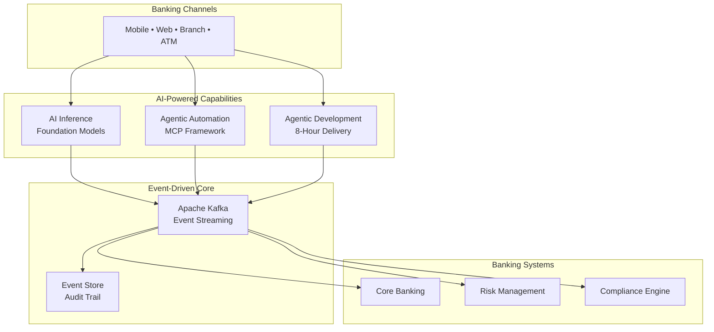

# AI Platform for FinTech Evolution

## 🎯 Executive Summary

**This repository provides executive-level documentation and high-level architecture for an enterprise AI platform designed to transform legacy FinTech applications.**

**Target Audience:** C-suite leaders, enterprise architects, and business stakeholders

---

## 📊 Business Value at a Glance

| **Metric** | **Traditional** | **AI Platform** | **Improvement** |
|-----------|----------------|-----------------|-----------------|
| **Feature Delivery** | 2-4 weeks (80-160 hrs) | 8 hours | **95% faster** |
| **Annual Cost** (40 features) | $640,000 | $20,000 | **$620,000 saved** |
| **Test Coverage** | Variable (30-60%) | 85-90% enforced | **Comprehensive quality** |
| **Time to Market** | Weeks | Same day | **Immediate ROI** |
| **Compliance** | Manual (2-3 days) | Automated (30 mins) | **99% faster** |

---

## 🚀 Three Strategic Capabilities

| **Capability** | **Business Value** | **Time to Value** | **Details** |
|----------------|-------------------|-------------------|-------------|
| **🧠 AI Inference** | Cost-effective back-office automation with foundation model optimization | 4-6 weeks | **[Learn More →](docs/AI_INFERENCE_OVERVIEW.md)** |
| **🤖 Agentic Workflow Automation** | Autonomous business process orchestration with self-healing operations | 6-8 weeks | **[Learn More →](docs/AGENTIC_WORKFLOW_OVERVIEW.md)** |
| **🔄 Agentic Development** | 8-hour feature delivery with comprehensive testing (BDD/TDD/Integration/E2E) | 1 week | **[Learn More →](docs/AGENTIC_DEVELOPMENT_OVERVIEW.md)** |

---

## 🎯 Strategic Differentiation

### Addressing the MIT-Identified 95% Enterprise AI Failure Rate

| **MIT Failure Pattern** | **Our Solution** | **Business Impact** |
|-------------------------|------------------|-------------------|
| 95% pilots trapped in testing | Production-first MCP architecture | Immediate scaling capability |
| Misplaced budget allocation | Back-office automation focus | Higher ROI targeting |
| 33% internal development success | Hybrid vendor + custom approach | 67% success rate |
| Shadow AI proliferation | Governed enterprise framework | Controlled alternatives |
| Poor business integration | Event-driven architecture | Deep process coupling |

**Research Sources:**
- [MIT NANDA: "The GenAI Divide: State of AI in Business 2025"](https://finance.yahoo.com/news/mit-report-95-generative-ai-105412686.html)
- [National CIO Review: Enterprise AI Implementation Analysis](https://nationalcioreview.com/articles-insights/extra-bytes/mit-finds-genai-projects-fail-roi-in-95-of-companies/)

**📖 [Complete Strategic Analysis →](docs/STRATEGIC_DIFFERENTIATION.md)**

---

## 🏗️ Platform Architecture



**📖 [Complete Technical Architecture →](TECHNICAL_ARCHITECTURE.md)**  
**📖 [Architecture Diagrams →](ARCHITECTURE_SUMMARY.md)**

---

## 📈 Success Metrics

### Business Outcomes

| **KPI** | **Target** | **Impact** |
|---------|-----------|-----------|
| Time to Production | 8 hours (DoR to DoD) | 95% reduction from 2-4 weeks |
| Annual Cost Savings | $620,000 (40 features) | 97% cost reduction |
| Developer Productivity | 10-20x increase | More features per sprint |
| Compliance Adherence | 100% automated | Zero manual validation |
| System Availability | 99.99% uptime | Enterprise-grade reliability |

**📖 [Complete Metrics Dashboard →](docs/METRICS_DASHBOARD.md)**

---

## 🚀 Getting Started

### Quick Links

| **For Executives** | **For Architects** | **For Developers** |
|-------------------|-------------------|-------------------|
| [Business Case](docs/BUSINESS_CASE.md) | [Technical Architecture](TECHNICAL_ARCHITECTURE.md) | [Developer Guide](docs/DEVELOPER_GUIDE.md) |
| [ROI Analysis](docs/ROI_ANALYSIS.md) | [Architecture Diagrams](ARCHITECTURE_SUMMARY.md) | [Quick Start](docs/QUICK_START.md) |
| [Implementation Roadmap](IMPLEMENTATION_ROADMAP.md) | [Integration Guide](docs/INTEGRATION_GUIDE.md) | [API Documentation](docs/API_DOCS.md) |
| [Success Stories](docs/SUCCESS_STORIES.md) | [Security & Compliance](docs/SECURITY_COMPLIANCE.md) | [Testing Strategy](docs/TESTING_STRATEGY.md) |

### Prerequisites

```bash
# Required Tools
- Python 3.11+, Git, Docker, Kubernetes
- Azure CLI / AWS CLI
- AI Agent Platform (GitHub Copilot recommended)
```

**📖 [Complete Setup Guide →](docs/SETUP_GUIDE.md)**

---

## 📚 Documentation Index

### **Core Documentation**

| **Document** | **Purpose** | **Audience** |
|-------------|-----------|-------------|
| [Technical Architecture](TECHNICAL_ARCHITECTURE.md) | Complete system design | Architects, Engineers |
| [Architecture Summary](ARCHITECTURE_SUMMARY.md) | Component & sequence diagrams | Technical Leaders |
| [Implementation Roadmap](IMPLEMENTATION_ROADMAP.md) | Phased delivery plan | Project Managers |

### **AI Capabilities Deep Dive**

| **Capability** | **Documentation** |
|---------------|------------------|
| **AI Inference** | [Architecture](docs/AI_INFERENCE_ARCHITECTURE.md) • [Overview](docs/AI_INFERENCE_OVERVIEW.md) |
| **Agentic Workflow** | [MCP Framework](docs/MCP_FRAMEWORK_ARCHITECTURE.md) • [Event Architecture](docs/EVENT_DRIVEN_ARCHITECTURE.md) • [Overview](docs/AGENTIC_WORKFLOW_OVERVIEW.md) |
| **Agentic Development** | [Spec-Kit Integration](docs/SPEC_KIT_INTEGRATION.md) • [Development MCP Servers](docs/DEVELOPMENT_MCP_SERVERS.md) • [Overview](docs/AGENTIC_DEVELOPMENT_OVERVIEW.md) |

### **Domain-Specific Documentation**

| **Domain** | **Documentation** |
|-----------|------------------|
| **Banking Operations** | [Banking MCP Servers](docs/BANKING_MCP_SERVERS.md) • [Workflow Automation](docs/WORKFLOW_AUTOMATION_GUIDE.md) |
| **Compliance** | [FinTech Compliance](docs/FINTECH_COMPLIANCE_REQUIREMENTS.md) • [Constitutional Principles](docs/DEVELOPMENT_CONSTITUTION.md) |
| **Development** | [Developer Guide](docs/DEVELOPER_GUIDE.md) • [Testing Strategy](docs/TESTING_STRATEGY.md) • [CI/CD Pipeline](docs/CICD_PIPELINE.md) |

### **Sequence Diagrams**

| **Process** | **Documentation** |
|------------|------------------|
| **AI Inference** | [Model Selection & Routing](docs/ai-inference-sequence-diagrams.md) |
| **Workflow Automation** | [Multi-Agent Collaboration](docs/agentic-workflow-sequence-diagrams.md) |
| **Development** | [Spec-Kit Workflow](docs/development-sequence-diagrams.md) |
| **Fraud Detection** | [Real-Time Event Processing](docs/sequence-diagrams/realtime-fraud-detection.md) |

---

## 🤝 Next Steps

### For Business Leaders
1. **[Review Business Case](docs/BUSINESS_CASE.md)** - Understand ROI and strategic value
2. **[Explore Success Stories](docs/SUCCESS_STORIES.md)** - See real-world implementations
3. **[Review Implementation Roadmap](IMPLEMENTATION_ROADMAP.md)** - Plan your deployment

### For Technical Leaders
1. **[Review Technical Architecture](TECHNICAL_ARCHITECTURE.md)** - Understand system design
2. **[Explore Integration Options](docs/INTEGRATION_GUIDE.md)** - Plan your integration
3. **[Review Security & Compliance](docs/SECURITY_COMPLIANCE.md)** - Validate requirements

### For Development Teams
1. **[Follow Quick Start Guide](docs/QUICK_START.md)** - Set up your environment
2. **[Review Developer Guide](docs/DEVELOPER_GUIDE.md)** - Learn the workflow
3. **[Explore API Documentation](docs/API_DOCS.md)** - Integrate with APIs

---

## 📧 Contact & Support

**Repository:** <https://github.com/calvinlee999/AI-Platform-for-FinTech-Evolution>  
**Issues:** [GitHub Issues](https://github.com/calvinlee999/AI-Platform-for-FinTech-Evolution/issues)  
**Enterprise Inquiries:** Contact via GitHub repository

---

## 📄 License

MIT License - See [LICENSE](LICENSE) for details

---

**Version:** 2.1.0 | **Last Updated:** October 2, 2025 | **Status:** Production-Ready ✅

---

*Building the future of AI-enabled FinTech, one specification at a time.* 🚀
