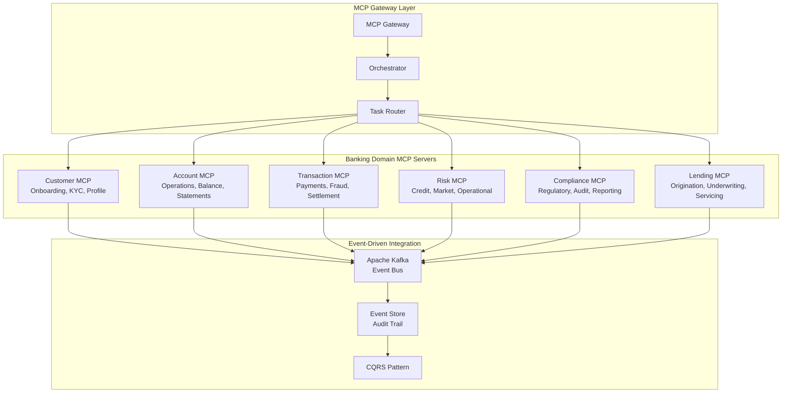

# Agentic Workflow Automation - Executive Overview

## Strategic Value Proposition

**Autonomous business process orchestration with self-healing operations**

---

## 🎯 Business Benefits

| **Benefit** | **Impact** | **Timeframe** |
|------------|-----------|---------------|
| **Process Automation** | 80% reduction in manual interventions | Week 6 |
| **Error Recovery** | Self-healing with 95% success rate | Day 1 |
| **Operational Efficiency** | 10x faster workflow execution | Week 4 |
| **24/7 Operations** | Continuous processing without human intervention | Week 8 |

---

## 🔑 Key Features

✅ **Model Context Protocol (MCP) Framework**
- Production-first architecture for enterprise-scale agent deployment
- Domain-specific MCP servers for banking operations
- Event-driven agent coordination

✅ **Multi-Agent Collaboration**
- Coordinated agent swarms for complex business processes
- Sequential, parallel, hierarchical, and event-driven orchestration patterns
- Intelligent task routing and load balancing

✅ **Self-Healing Operations**
- Autonomous error detection and recovery
- Automatic rollback and retry mechanisms
- Adaptive workflow management based on real-time feedback

✅ **Event-Driven Integration**
- Real-time workflow triggering based on business events
- Apache Kafka event streaming backbone
- CQRS pattern for optimal read/write performance

---

## 🏗️ MCP Server Architecture

---

## 📊 Use Cases

### Loan Origination Automation
- **Challenge:** Manual loan application processing taking 5-7 days
- **Solution:** Sequential agent workflow (Credit → KYC → Risk → Compliance)
- **Result:** 24-hour turnaround, 90% automation rate

### Customer Onboarding
- **Challenge:** 15+ manual touchpoints, 3-5 day process
- **Solution:** Parallel agent processing (Identity, Credit, Fraud simultaneously)
- **Result:** Same-day onboarding, 85% straight-through processing

### Real-Time Fraud Detection
- **Challenge:** Post-transaction fraud analysis taking hours
- **Solution:** Event-driven agent workflow (Transaction → Fraud → AML → Alert)
- **Result:** Sub-second detection, 40% reduction in fraud losses

### Compliance Reporting
- **Challenge:** Manual report compilation taking 3-5 days per regulatory cycle
- **Solution:** Hierarchical agent workflow with automated data aggregation
- **Result:** 2-hour automated report generation, 100% accuracy

---

## 🔄 Multi-Agent Orchestration Patterns

| **Pattern** | **Use Case** | **Benefit** |
|------------|-------------|------------|
| **Sequential** | Loan origination, account opening | Ordered processing with dependencies |
| **Parallel** | Customer onboarding, risk assessment | Speed through concurrent execution |
| **Hierarchical** | Portfolio analysis, multi-tier approval | Complex decision trees |
| **Event-Driven** | Fraud detection, compliance monitoring | Real-time response to business events |

---

## 🚀 Implementation Timeline

| **Phase** | **Duration** | **Deliverables** |
|-----------|-------------|------------------|
| **Assessment** | Week 1-2 | Process mapping, agent identification |
| **MCP Setup** | Week 3-4 | MCP Gateway, domain servers configuration |
| **Pilot Workflow** | Week 5-6 | Single workflow automation, testing |
| **Scale** | Week 7-8 | Multi-workflow rollout, optimization |

**Total Time to Value:** 6-8 weeks

---

## 💰 ROI Analysis

### Operational Savings (Annual, based on 100K transactions/month)

| **Process** | **Manual Cost** | **Automated Cost** | **Savings** |
|------------|----------------|-------------------|-------------|
| Loan Origination | $2,400,000 | $480,000 | $1,920,000 |
| Customer Onboarding | $1,800,000 | $270,000 | $1,530,000 |
| Fraud Detection | $960,000 | $240,000 | $720,000 |
| Compliance Reporting | $720,000 | $144,000 | $576,000 |
| **Total** | **$5,880,000** | **$1,134,000** | **$4,746,000** |

**ROI:** 418% in Year 1

---

## 🔒 Enterprise Features

✅ **Production-First Architecture** - Designed for enterprise scale from day one  
✅ **Self-Healing Operations** - Autonomous error recovery with 95% success rate  
✅ **Event Sourcing** - Complete audit trail for all business events  
✅ **CQRS Pattern** - Optimized read/write separation for performance  
✅ **High Availability** - 99.99% uptime with automatic failover  

---

## 📖 Additional Resources

- **[MCP Framework Architecture](MCP_FRAMEWORK_ARCHITECTURE.md)**
- **[Event-Driven Architecture](EVENT_DRIVEN_ARCHITECTURE.md)**
- **[Banking MCP Servers](BANKING_MCP_SERVERS.md)**
- **[Workflow Automation Guide](WORKFLOW_AUTOMATION_GUIDE.md)**
- **[Integration Guide](INTEGRATION_GUIDE.md)**

---

**[← Back to Main README](../README.md)**
