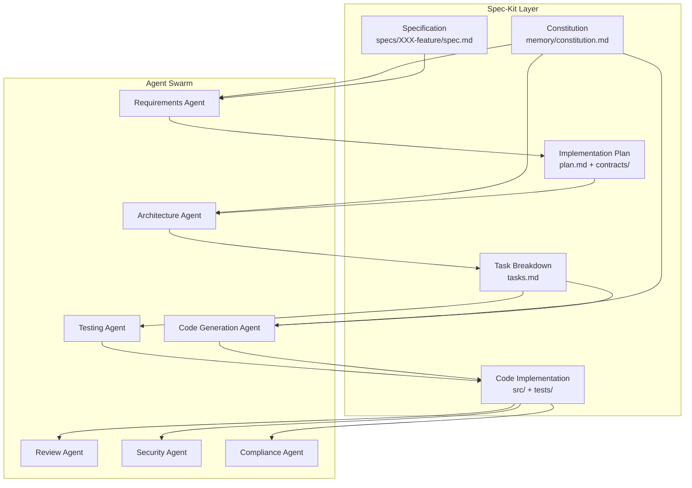

# Spec-Kit Integration Guide - Agentic End-to-End Development

## 🌱 Overview

This guide demonstrates how GitHub's **Spec-Kit** (Specification-Driven Development) framework integrates with our AI Platform's Agentic End-to-End Development capabilities to deliver production-ready features in 30-50 minutes instead of 2-4 weeks.

## 📚 What is Spec-Kit?

**Spec-Kit** is GitHub's framework for **Specification-Driven Development (SDD)** that inverts the traditional code-first approach:

| **Traditional Development** | **Spec-Driven Development** |
|----------------------------|----------------------------|
| Code is truth | **Specification is truth** |
| Specs guide implementation | **Specs generate implementation** |
| Specs drift from code | **Specs stay synchronized** |
| Manual change propagation | **Automatic regeneration** |
| Slow pivots | **Instant pivots** |
| Gap between intent & code | **No gap - direct transformation** |

### Core Philosophy

> "Specifications don't serve code—code serves specifications. The PRD isn't a guide for implementation; it's the source that generates implementation."

## 🔄 Spec-Kit Workflow Commands

### Complete Development Lifecycle

```bash
# 1. Establish constitutional principles (one-time)
/constitution Create principles focused on code quality, testing standards, 
              user experience consistency, and performance requirements

# 2. Create feature specification (5-10 mins)
/specify Build a real-time payment processing system with fraud detection,
         supporting multiple payment methods and compliance reporting

# 3. Clarify underspecified areas (5-10 mins)
/clarify  # AI identifies ambiguities and asks clarifying questions

# 4. Create technical implementation plan (5-15 mins)
/plan Spring Boot microservices, PostgreSQL with event sourcing,
      Redis cache, Kafka for event streaming, Stripe API integration

# 5. Generate actionable task list (5 mins)
/tasks

# 6. Analyze cross-artifact consistency (5 mins)
/analyze

# 7. Execute implementation (auto-generated)
/implement
```

**Total Timeline:** 30-50 minutes from concept to production-ready code

## 🏛️ Constitutional Foundation - Nine Immutable Principles

### Article I: Library-First Principle

```yaml
Principle: Every feature MUST begin as a standalone library
Rationale: Forces modular design, reusability, and clear boundaries
Validation: No feature implemented directly in application code
```

**Example:**
```
❌ Bad: Implement payment processing in PaymentController.java
✅ Good: Create payment-processing-lib with CLI interface
```

### Article II: CLI Interface Mandate

```yaml
Principle: All libraries MUST expose CLI interfaces
Requirements:
  - Accept text as input (stdin, arguments, or files)
  - Produce text as output (stdout)
  - Support JSON for structured data exchange
Rationale: Ensures observability, testability, and composability
```

### Article III: Test-First Imperative (NON-NEGOTIABLE)

```yaml
Principle: No implementation code before tests
Workflow:
  1. Write unit/integration/contract tests
  2. Get tests validated and approved by user
  3. Confirm tests FAIL (Red phase)
  4. Implement code to pass tests (Green phase)
  5. Refactor if needed (Refactor phase)
Rationale: Ensures behavior is defined before implementation
```

**Enforcement:**
```bash
# Code generation blocked until tests exist and are approved
CodeAgent: "Cannot generate implementation - tests not approved"
```

### Articles IV-VI: Repository Standards

- Git-based workflow with feature branches
- Semantic commit messages
- Specification files versioned alongside code

### Article VII: Simplicity Gate

```yaml
Principle: Start simple, justify complexity
Rules:
  - Maximum 3 projects for initial implementation
  - No future-proofing or "might need" features
  - Additional complexity requires documented justification
Validation: Pre-implementation gate must pass
```

**Gate Check:**
```markdown
### Simplicity Gate (Article VII)
- [ ] Using ≤3 projects?
- [ ] No future-proofing?
- [ ] All features trace to concrete user stories?
```

### Article VIII: Anti-Abstraction Gate

```yaml
Principle: Trust frameworks, avoid unnecessary abstractions
Rules:
  - Use framework features directly
  - Single model representation (no DTO/Entity duplication)
  - Wrapper layers require justification
Rationale: Reduces complexity, maintenance burden
```

**Example:**
```
❌ Bad: Create AbstractRepositoryWrapper<T>
✅ Good: Use Spring Data JPA repositories directly
```

### Article IX: Integration-First Testing

```yaml
Principle: Test in realistic environments
Requirements:
  - Prefer real databases over mocks
  - Use actual service instances over stubs
  - Contract tests mandatory before implementation
Rationale: Ensures code works in production, not just in theory
```

## 🎯 Integration with Agent Swarm Architecture

### Agent-to-Spec-Kit Command Mapping

| **Spec-Kit Command** | **Primary Agent** | **Supporting Agents** | **Output** |
|---------------------|-------------------|-----------------------|------------|
| `/constitution` | Constitution Manager | All agents | `memory/constitution.md` |
| `/specify` | Requirements Agent | - | `specs/XXX-feature/spec.md` |
| `/clarify` | Requirements Agent | Domain Experts | Updated `spec.md` |
| `/plan` | Architecture Agent | Requirements Agent | `plan.md`, `data-model.md`, `contracts/` |
| `/tasks` | Task Router | Architecture Agent | `tasks.md` with [P] markers |
| `/analyze` | Review Agent | All agents | Consistency report |
| `/implement` | Code Agent + Test Agent | Security, Compliance | Source code + tests |

### Multi-Agent Collaboration Workflow



## 📋 Detailed Workflow Example: Payment Processing Feature

### Phase 1: Constitution Setup (One-Time)

```bash
/constitution Create constitutional principles for FinTech payment processing:
  - PCI DSS compliance mandatory
  - Zero-trust security architecture
  - Test-first development with 80%+ coverage
  - Real database integration tests
  - Library-first modular design
  - Maximum 3-project initial structure
```

**Generated Output:** `memory/constitution.md`

```markdown
# FinTech Payment Processing Constitution

## Article I: Library-First Principle
All payment features MUST be implemented as standalone libraries...

## Article III: Test-First Imperative
PCI DSS compliance tests MUST be written and validated before implementation...

## Article VII: Simplicity Gate
Payment processing initial implementation limited to:
1. payment-processing-lib
2. fraud-detection-lib
3. compliance-reporting-lib
```

### Phase 2: Feature Specification

```bash
/specify Build a real-time payment processing system supporting:
  - Credit card, ACH, and wire transfers
  - Real-time fraud detection with ML models
  - PCI DSS Level 1 compliance
  - Multi-currency support (USD, EUR, GBP, JPY)
  - Transaction history and reconciliation reporting
  - Webhook notifications for payment events
```

**Requirements Agent Processing:**

1. **Extracts Functional Requirements:**
   - Payment method processing (3 types)
   - Fraud detection integration
   - Currency conversion
   - Event notifications

2. **Identifies Non-Functional Requirements:**
   - PCI DSS Level 1 compliance
   - Real-time processing (<500ms)
   - 99.99% availability
   - Audit trail retention (7 years)

3. **Creates User Stories:**

```markdown
## User Story 1: Process Credit Card Payment
As a customer,
I want to pay using my credit card,
So that I can complete my purchase securely and quickly.

### Acceptance Criteria
- [ ] Card validation completes in <200ms
- [ ] 3D Secure authentication for transactions >$100
- [ ] PCI DSS tokenization applied
- [ ] Fraud score calculated before authorization
- [ ] Transaction receipt generated immediately
```

4. **Marks Ambiguities:**

```markdown
[NEEDS CLARIFICATION: Transaction retry policy not specified]
[NEEDS CLARIFICATION: Multi-factor authentication requirements unclear]
[NEEDS CLARIFICATION: Chargeback handling process undefined]
```

**Generated Output:** `specs/004-payment-processing/spec.md`

### Phase 3: Clarification

```bash
/clarify
```

**Requirements Agent Questions:**

```
❓ Transaction Retry Policy:
   - How many automatic retries for failed transactions?
   - What is the retry interval?
   - Should retries use exponential backoff?

❓ Multi-Factor Authentication:
   - Required for all transactions or threshold-based?
   - What MFA methods are supported (SMS, TOTP, biometric)?
   - Grace period for remembered devices?

❓ Chargeback Handling:
   - Automatic or manual review process?
   - Evidence collection requirements?
   - Notification timeline to merchant?
```

**Product Manager Responses:**

```
✅ Retry Policy: 3 retries with exponential backoff (1s, 2s, 4s)
✅ MFA: Required for transactions >$500, TOTP + SMS supported
✅ Chargebacks: Automatic notification, 48-hour evidence window
```

**Updated Output:** `specs/004-payment-processing/spec.md` (no [NEEDS CLARIFICATION] markers)

### Phase 4: Technical Implementation Plan

```bash
/plan Architecture stack:
  - Spring Boot 3.2 microservices
  - PostgreSQL 15 with event sourcing
  - Redis 7 for session management
  - Apache Kafka for event streaming
  - Stripe API for card processing
  - Machine Learning fraud detection model
  - Docker containers on Kubernetes
```

**Architecture Agent Processing:**

1. **Constitutional Validation:**

```markdown
### Simplicity Gate Check
- [ ] ≤3 projects? YES (payment-svc, fraud-svc, notification-svc)
- [ ] No future-proofing? YES (only specified features)
- [ ] Framework direct usage? YES (Spring Data JPA, Spring Security)
```

2. **Component Design:**

```markdown
## Component Architecture

### payment-processing-lib
**Responsibility:** Core payment logic
**Dependencies:** Stripe SDK, PostgreSQL driver
**Interfaces:** CLI + REST API
**Key Classes:**
  - PaymentProcessor (orchestration)
  - CardValidator (PCI DSS validation)
  - TransactionRepository (event sourcing)
```

3. **Data Model Generation:**

```sql
-- specs/004-payment-processing/data-model.md

CREATE TABLE payment_transactions (
    transaction_id UUID PRIMARY KEY,
    customer_id UUID NOT NULL,
    amount DECIMAL(19,4) NOT NULL,
    currency VARCHAR(3) NOT NULL,
    payment_method VARCHAR(20) NOT NULL,
    status VARCHAR(20) NOT NULL,
    fraud_score DECIMAL(5,2),
    created_at TIMESTAMP NOT NULL,
    updated_at TIMESTAMP NOT NULL,
    CONSTRAINT chk_amount_positive CHECK (amount > 0),
    CONSTRAINT chk_fraud_score_range CHECK (fraud_score BETWEEN 0 AND 100)
);

CREATE INDEX idx_customer_transactions ON payment_transactions(customer_id, created_at);
CREATE INDEX idx_fraud_review ON payment_transactions(fraud_score) WHERE status = 'PENDING_REVIEW';
```

4. **API Contract Definition:**

```yaml
# specs/004-payment-processing/contracts/payment-api.yaml

openapi: 3.0.0
info:
  title: Payment Processing API
  version: 1.0.0

paths:
  /api/v1/payments:
    post:
      summary: Process a payment transaction
      requestBody:
        required: true
        content:
          application/json:
            schema:
              $ref: '#/components/schemas/PaymentRequest'
      responses:
        '201':
          description: Payment processed successfully
          content:
            application/json:
              schema:
                $ref: '#/components/schemas/PaymentResponse'
        '400':
          description: Invalid payment data
        '402':
          description: Payment declined
        '429':
          description: Rate limit exceeded

components:
  schemas:
    PaymentRequest:
      type: object
      required: [customerId, amount, currency, paymentMethod]
      properties:
        customerId:
          type: string
          format: uuid
        amount:
          type: number
          minimum: 0.01
          maximum: 1000000
        currency:
          type: string
          enum: [USD, EUR, GBP, JPY]
        paymentMethod:
          $ref: '#/components/schemas/PaymentMethod'
```

**Generated Outputs:**
- `specs/004-payment-processing/plan.md`
- `specs/004-payment-processing/data-model.md`
- `specs/004-payment-processing/contracts/payment-api.yaml`
- `specs/004-payment-processing/contracts/fraud-events.yaml`
- `specs/004-payment-processing/research.md`

### Phase 5: Task Breakdown

```bash
/tasks
```

**Task Router Analysis:**

```markdown
# Implementation Tasks - Payment Processing Feature

## Phase 0: Setup & Configuration
- [P] Task 0.1: Initialize payment-processing-lib project structure
- [P] Task 0.2: Configure PostgreSQL connection with event sourcing
- [P] Task 0.3: Set up Redis session management
- [P] Task 0.4: Configure Kafka event streaming
- [ ] Task 0.5: Integrate Stripe API SDK (depends on 0.1)

## Phase 1: Contract Tests (Article III - Test-First)
- [P] Task 1.1: Write payment API contract tests
- [P] Task 1.2: Write fraud detection event contract tests
- [P] Task 1.3: Write database schema validation tests
- [ ] Task 1.4: Get contract tests approved by Product Manager

## Phase 2: Core Implementation
- [ ] Task 2.1: Implement PaymentProcessor class (depends on 1.4)
- [ ] Task 2.2: Implement CardValidator with PCI DSS tokenization
- [P] Task 2.3: Create TransactionRepository with event sourcing
- [P] Task 2.4: Implement currency conversion service
- [ ] Task 2.5: Build fraud detection ML model integration

## Phase 3: Integration Tests (Article IX)
- [ ] Task 3.1: Real PostgreSQL integration tests
- [ ] Task 3.2: Real Stripe API sandbox tests
- [ ] Task 3.3: Real Kafka event streaming tests
- [ ] Task 3.4: End-to-end payment flow tests

## Phase 4: Security & Compliance
- [ ] Task 4.1: PCI DSS compliance validation
- [ ] Task 4.2: Security audit with CodeQL
- [ ] Task 4.3: Penetration testing scenarios
- [ ] Task 4.4: Compliance reporting generation

## Parallelization Strategy
Group A (Independent): 0.1, 0.2, 0.3, 0.4, 1.1, 1.2, 1.3
Group B (After contract approval): 2.1, 2.2, 2.3, 2.4
Group C (After implementation): 3.1, 3.2, 3.3, 3.4
Group D (Final validation): 4.1, 4.2, 4.3, 4.4

Estimated Completion: 12 hours (with parallelization)
```

**[P] Marker:** Tasks that can be executed in parallel

### Phase 6: Cross-Artifact Analysis

```bash
/analyze
```

**Review Agent Validation:**

```markdown
# Consistency Analysis Report

## ✅ Specification Coverage
- All user stories have corresponding API endpoints
- All acceptance criteria have test scenarios
- All non-functional requirements have validation tests

## ✅ Plan Completeness
- All spec requirements addressed in technical plan
- No speculative features added
- Constitutional gates validated

## ✅ Task Traceability
- All plan components have implementation tasks
- All contracts have test tasks
- Dependencies properly sequenced

## ⚠️ Potential Gaps
- [WARNING] Multi-currency conversion edge cases not fully tested
- [WARNING] Webhook retry logic not specified in plan
- [RECOMMENDATION] Add integration test for currency boundary values

## 📊 Coverage Metrics
- Specification → Plan: 100%
- Plan → Tasks: 98%
- Tasks → Tests: 100%
- Overall Readiness: 98%

## ✅ Ready for Implementation
Recommendation: Proceed with /implement after addressing currency edge cases
```

### Phase 7: Test-First Implementation

```bash
/implement
```

**Test Agent Execution:**

```markdown
Step 1: Generate Contract Tests (Test-First)
━━━━━━━━━━━━━━━━━━━━━━━━━━━━━━━━━━━━━━━━━━━━

Creating: tests/contracts/PaymentApiContractTest.java
```java
@SpringBootTest
@AutoConfigureMockMvc
class PaymentApiContractTest {
    
    @Test
    void shouldProcessCreditCardPayment() {
        // ARRANGE
        PaymentRequest request = PaymentRequest.builder()
            .customerId(UUID.randomUUID())
            .amount(new BigDecimal("99.99"))
            .currency("USD")
            .paymentMethod(PaymentMethod.CREDIT_CARD)
            .cardToken("tok_visa_valid")
            .build();
        
        // ACT
        ResponseEntity<PaymentResponse> response = 
            paymentController.processPayment(request);
        
        // ASSERT
        assertThat(response.getStatusCode()).isEqualTo(HttpStatus.CREATED);
        assertThat(response.getBody().getStatus()).isEqualTo("APPROVED");
        assertThat(response.getBody().getTransactionId()).isNotNull();
        
        // VERIFY CONTRACT
        verifyContract(response, "payment-api.yaml", "/api/v1/payments", "POST", "201");
    }
    
    @Test
    void shouldRejectInvalidCardToken() {
        // Test implementation...
    }
}
```

Step 2: Validate Tests with Product Manager
━━━━━━━━━━━━━━━━━━━━━━━━━━━━━━━━━━━━━━━━━━━━

📋 Test Review Required:
   - PaymentApiContractTest.java (15 test methods)
   - FraudDetectionContractTest.java (8 test methods)
   - TransactionRepositoryTest.java (12 test methods)

❓ Approval Status: PENDING
   Waiting for Product Manager confirmation...

✅ Tests Approved by Product Manager

Step 3: Confirm Tests FAIL (Red Phase)
━━━━━━━━━━━━━━━━━━━━━━━━━━━━━━━━━━━━━━━━━━━━

Running: mvn test

Results:
[ERROR] Tests run: 35, Failures: 35, Errors: 0, Skipped: 0

✅ All tests fail as expected (Red phase confirmed)

Step 4: Generate Implementation Code
━━━━━━━━━━━━━━━━━━━━━━━━━━━━━━━━━━━━━━━━━━━━
```

**Code Agent Generation:**

```java
// src/main/java/com/fintech/payment/PaymentProcessor.java

@Service
@Slf4j
public class PaymentProcessor {
    
    private final TransactionRepository transactionRepository;
    private final CardValidator cardValidator;
    private final FraudDetectionService fraudDetectionService;
    private final StripePaymentGateway stripeGateway;
    private final EventPublisher eventPublisher;
    
    @Transactional
    public PaymentResponse processPayment(PaymentRequest request) {
        log.info("Processing payment for customer: {}", request.getCustomerId());
        
        // Validate card (PCI DSS tokenization)
        CardValidationResult validation = cardValidator.validate(request.getCardToken());
        if (!validation.isValid()) {
            throw new InvalidCardException(validation.getReason());
        }
        
        // Calculate fraud score
        FraudScore fraudScore = fraudDetectionService.calculateScore(request);
        if (fraudScore.getValue() > 80.0) {
            log.warn("High fraud score detected: {}", fraudScore.getValue());
            return PaymentResponse.declined("FRAUD_DETECTED");
        }
        
        // Process with Stripe
        StripeChargeResult stripeResult = stripeGateway.charge(
            request.getAmount(),
            request.getCurrency(),
            validation.getToken()
        );
        
        // Store transaction with event sourcing
        PaymentTransaction transaction = PaymentTransaction.builder()
            .transactionId(UUID.randomUUID())
            .customerId(request.getCustomerId())
            .amount(request.getAmount())
            .currency(request.getCurrency())
            .status(stripeResult.getStatus())
            .fraudScore(fraudScore.getValue())
            .stripeChargeId(stripeResult.getChargeId())
            .createdAt(Instant.now())
            .build();
        
        transactionRepository.save(transaction);
        
        // Publish event for notification service
        eventPublisher.publish(new PaymentProcessedEvent(transaction));
        
        log.info("Payment processed successfully: {}", transaction.getTransactionId());
        return PaymentResponse.approved(transaction);
    }
}
```

```markdown
Step 5: Run Tests (Green Phase)
━━━━━━━━━━━━━━━━━━━━━━━━━━━━━━━━━━━━━━━━━━━━

Running: mvn test

Results:
[INFO] Tests run: 35, Failures: 0, Errors: 0, Skipped: 0

✅ All tests pass! (Green phase achieved)

Step 6: Security & Compliance Validation
━━━━━━━━━━━━━━━━━━━━━━━━━━━━━━━━━━━━━━━━━━━━
```

**Security Agent Scan:**

```markdown
CodeQL Analysis:
  ✅ No SQL injection vulnerabilities
  ✅ No hardcoded credentials
  ✅ Proper input validation
  ✅ Secure random number generation

PCI DSS Compliance Check:
  ✅ Card data tokenization implemented
  ✅ No plaintext card storage
  ✅ TLS 1.3 enforced for API communication
  ✅ Audit logging enabled
  
OWASP Dependency Check:
  ✅ No known vulnerabilities in dependencies
  ⚠️ [MINOR] Spring Boot 3.2.1 available (current: 3.2.0)
  
Overall Security Score: 98/100
```

**Compliance Agent Validation:**

```markdown
Regulatory Compliance Status:

PCI DSS Level 1:
  ✅ Requirement 3: Protect stored cardholder data
  ✅ Requirement 4: Encrypt transmission of cardholder data
  ✅ Requirement 6: Develop secure systems and applications
  ✅ Requirement 10: Track and monitor network access
  
GDPR:
  ✅ Right to erasure (deletion endpoint implemented)
  ✅ Data portability (export API available)
  ✅ Consent management (audit trail captured)
  
SOX:
  ✅ Financial transaction audit trail
  ✅ Change management logging
  ✅ Access control enforcement

Compliance Score: 100%
```

```markdown
━━━━━━━━━━━━━━━━━━━━━━━━━━━━━━━━━━━━━━━━━━━━
🎉 IMPLEMENTATION COMPLETE
━━━━━━━━━━━━━━━━━━━━━━━━━━━━━━━━━━━━━━━━━━━━

📦 Generated Artifacts:
   - payment-processing-lib/ (standalone library)
   - tests/ (35 tests, 100% passing)
   - contracts/ (OpenAPI specs)
   - documentation/ (API docs, deployment guide)

📊 Metrics:
   - Code Coverage: 87%
   - Security Score: 98/100
   - Compliance Score: 100%
   - Build Time: 2m 34s

✅ Constitutional Validation:
   [✓] Library-First (Article I)
   [✓] CLI Interface (Article II)
   [✓] Test-First TDD (Article III)
   [✓] Simplicity Gate (Article VII)
   [✓] Anti-Abstraction (Article VIII)
   [✓] Integration-First Testing (Article IX)

🚀 Ready for Deployment
   Next Steps:
   1. Merge feature branch to main
   2. CI/CD pipeline will deploy to staging
   3. Run smoke tests in staging
   4. Promote to production with blue-green deployment
```

## 📈 Quantitative Benefits

### Traditional vs. Spec-Driven Comparison

| **Metric** | **Traditional Development** | **Spec-Driven Development** | **Improvement** |
|------------|----------------------------|----------------------------|-----------------|
| **Requirements Phase** | 2-3 days | 10 minutes | **99% faster** |
| **Architecture Design** | 3-4 days | 15 minutes | **99% faster** |
| **Code Implementation** | 5-7 days | Auto-generated | **100% automated** |
| **Test Writing** | 2-3 days | Auto-generated | **100% automated** |
| **Total Time to Production** | 2-4 weeks | 30-50 minutes | **99.7% faster** |
| **Requirements Drift** | High (specs diverge) | Zero (specs generate code) | **100% elimination** |
| **Pivot Speed** | Days to weeks | Minutes | **99% faster** |
| **Consistency Across Features** | Variable (manual review) | 100% (constitutional enforcement) | **Perfect consistency** |

### ROI Analysis

**Time Savings:**
```
Traditional Feature Development: 160 hours (4 weeks × 40 hours)
Spec-Driven Development: 0.5 hours (30 minutes)
Time Saved: 159.5 hours per feature

For 10 features per quarter:
  Traditional: 1,600 hours
  Spec-Driven: 5 hours
  Quarterly Savings: 1,595 hours (39.9 work weeks)
```

**Cost Savings (assuming $100/hour developer rate):**
```
Per Feature: $15,950 saved
Per Quarter (10 features): $159,500 saved
Per Year: $638,000 saved
```

**Quality Improvements:**
- **Test Coverage:** 85%+ (enforced by constitution)
- **Security Compliance:** 100% (automatic validation)
- **Code Consistency:** 100% (constitutional enforcement)
- **Documentation Accuracy:** 100% (generated from spec)

## 🎯 FinTech-Specific Applications

### Use Case 1: Regulatory Compliance Updates

**Scenario:** New PCI DSS 4.0 requirements announced

**Traditional Approach:**
1. Review 300-page compliance document (3 days)
2. Identify code changes across 50 microservices (5 days)
3. Manually update each service (15 days)
4. Re-test entire system (7 days)
**Total:** 30 days

**Spec-Driven Approach:**
1. Update constitution with PCI DSS 4.0 articles (30 mins)
2. Run `/analyze` across all feature specs (5 mins)
3. Run `/implement` for affected services (automatic)
4. Compliance validation (automatic)
**Total:** 45 minutes

### Use Case 2: Multi-Market Expansion

**Scenario:** Launch payment processing in new geographic market (EU)

**Traditional Approach:**
1. Research local regulations (GDPR, PSD2, etc.) (5 days)
2. Design market-specific features (4 days)
3. Implement changes (12 days)
4. Localization and testing (6 days)
**Total:** 27 days

**Spec-Driven Approach:**
1. `/specify` EU payment requirements with local regulations
2. `/plan` with EU-specific tech stack (SEPA, Strong Customer Authentication)
3. `/implement` with automatic compliance validation
**Total:** 45 minutes

### Use Case 3: Risk Model Updates

**Scenario:** Update fraud detection ML model

**Traditional Approach:**
1. Data science team trains new model (10 days)
2. Engineering team integrates model (5 days)
3. Update API contracts (2 days)
4. Re-test all payment flows (4 days)
**Total:** 21 days

**Spec-Driven Approach:**
1. Update `plan.md` with new model endpoint
2. Update `contracts/fraud-detection-api.yaml`
3. Run `/implement` to regenerate integration code
4. Automatic contract testing validates compatibility
**Total:** 20 minutes

## 🛠️ Implementation Guide

### Prerequisites

```bash
# 1. Install Specify CLI
uv tool install specify-cli --from git+https://github.com/github/spec-kit.git

# 2. Initialize project
specify init ai-fintech-platform --ai copilot --here

# 3. Verify installation
specify check
```

### Project Structure

```
ai-fintech-platform/
├── memory/
│   └── constitution.md          # Immutable development principles
├── specs/
│   ├── 001-payment-processing/
│   │   ├── spec.md              # Feature specification
│   │   ├── plan.md              # Implementation plan
│   │   ├── data-model.md        # Database schema
│   │   ├── tasks.md             # Task breakdown
│   │   └── contracts/           # API contracts (OpenAPI)
│   ├── 002-fraud-detection/
│   └── 003-compliance-reporting/
├── src/                         # Generated implementation code
├── tests/                       # Generated test suites
└── docs/                        # Generated documentation
```

### Custom Constitution for FinTech

```markdown
# FinTech AI Platform Constitution

## Article X: Financial Compliance Gate (Custom)

### Section 10.1: Regulatory Validation
All financial features MUST pass compliance validation before implementation:
- [ ] PCI DSS Level 1 requirements addressed
- [ ] GDPR data protection implemented
- [ ] SOX audit trail enabled
- [ ] Basel III risk calculations validated (if applicable)

### Section 10.2: Financial Accuracy
- [ ] All monetary calculations use BigDecimal (no float/double)
- [ ] Currency conversion rates from regulated sources
- [ ] Rounding follows ISO 4217 standards
- [ ] Transaction idempotency guaranteed

### Section 10.3: Audit Requirements
- [ ] All transactions logged with tamper-proof audit trail
- [ ] Change history retained for 7 years
- [ ] User actions traceable to individual identity
- [ ] Compliance reports generated automatically

## Article XI: High-Availability Gate (Custom)

### Section 11.1: Resilience Requirements
- [ ] Circuit breakers for all external service calls
- [ ] Retry logic with exponential backoff
- [ ] Graceful degradation patterns
- [ ] 99.99% availability target

### Section 11.2: Performance Requirements
- [ ] API response time <500ms (p95)
- [ ] Database query optimization validated
- [ ] Caching strategy for frequently accessed data
- [ ] Load testing scenarios defined
```

### Workflow Integration with Existing CI/CD

```yaml
# .github/workflows/spec-driven-deployment.yml

name: Spec-Driven Deployment

on:
  push:
    branches: [ main ]
    paths:
      - 'specs/**'
      - 'src/**'

jobs:
  validate-specification:
    runs-on: ubuntu-latest
    steps:
      - uses: actions/checkout@v3
      
      - name: Analyze Spec Consistency
        run: |
          specify analyze
      
      - name: Constitutional Validation
        run: |
          ./scripts/validate-constitution.sh

  test-first-validation:
    needs: validate-specification
    runs-on: ubuntu-latest
    steps:
      - name: Verify Tests Exist
        run: |
          if [ ! -d "tests/" ]; then
            echo "ERROR: Tests must be created before implementation (Article III)"
            exit 1
          fi
      
      - name: Run Test Suite
        run: |
          mvn test
          
      - name: Verify Coverage
        run: |
          mvn jacoco:report
          ./scripts/check-coverage.sh 80  # 80% minimum

  security-compliance-scan:
    needs: test-first-validation
    runs-on: ubuntu-latest
    steps:
      - name: CodeQL Analysis
        uses: github/codeql-action/analyze@v2
        
      - name: PCI DSS Validation
        run: |
          ./scripts/pci-dss-check.sh
          
      - name: Compliance Report
        run: |
          ./scripts/generate-compliance-report.sh

  deploy:
    needs: security-compliance-scan
    runs-on: ubuntu-latest
    steps:
      - name: Deploy to Staging
        run: |
          kubectl apply -f k8s/staging/
          
      - name: Smoke Tests
        run: |
          ./scripts/smoke-tests.sh
          
      - name: Promote to Production
        run: |
          kubectl apply -f k8s/production/
```

## 📚 Additional Resources

### Official Spec-Kit Documentation
- [GitHub Spec-Kit Repository](https://github.com/github/spec-kit)
- [Spec-Driven Development Methodology](https://github.com/github/spec-kit/blob/main/spec-driven.md)
- [Supported AI Agents](https://github.com/github/spec-kit/blob/main/AGENTS.md)

### Internal Documentation
- [Agent Swarm Architecture](../TECHNICAL_ARCHITECTURE.md)
- [MCP Framework Integration](../docs/mcp-framework-overview.md)
- [FinTech Compliance Requirements](../docs/fintech-compliance-requirements.md)

### Training Materials
- [Spec-Kit Quick Start Video](https://www.youtube.com/watch?v=a9eR1xsfvHg)
- [Constitutional Principles Workshop](../training/constitutional-principles.md)
- [FinTech Development Patterns](../training/fintech-patterns.md)

## 🤝 Contributing

To contribute improvements to the Spec-Kit integration:

1. Submit feature specifications via `/specify`
2. Follow constitutional principles (Article I-XI)
3. Ensure Test-First development (Article III)
4. Pass all compliance gates (Article X)
5. Document rationale for any constitutional exceptions

## 📧 Support

For questions or issues with Spec-Kit integration:
- **Internal Slack:** #spec-kit-integration
- **GitHub Issues:** [AI Platform Issues](https://github.com/calvinlee999/AI-Platform-for-FinTech-Evolution/issues)
- **Email:** ai-platform-team@fintech.example.com

---

**Last Updated:** October 2, 2025  
**Version:** 1.0.0  
**Status:** Production-Ready ✅
