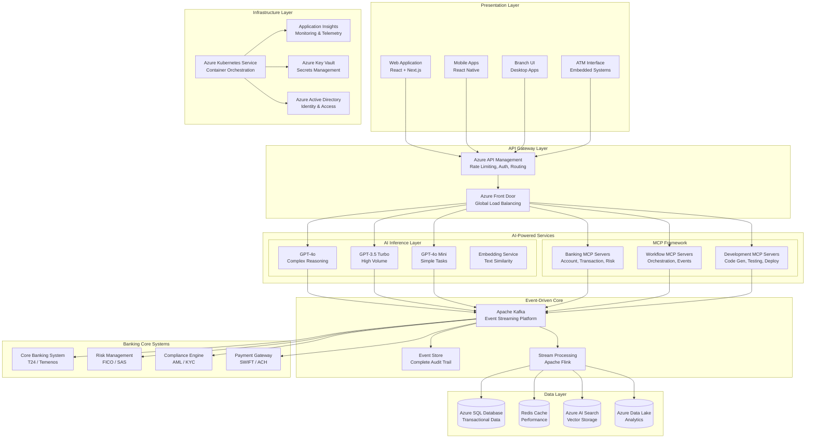
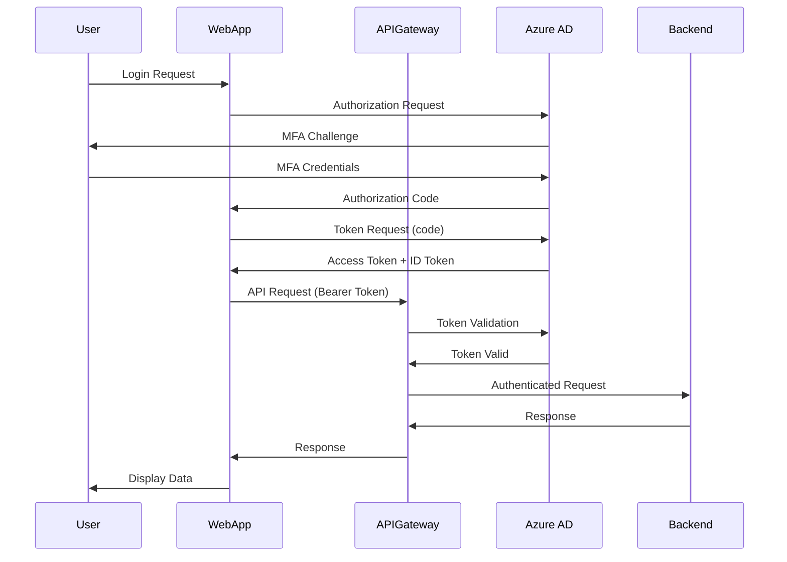

# Technical Design - AI Platform for FinTech Evolution

## Overview

This document provides detailed technical design specifications for the AI Platform, including architecture patterns, technology stack decisions, integration patterns, and implementation guidelines.

**Target Audience:** Enterprise Architects, Solution Architects, Senior Engineers

---

## 🏗️ Detailed Platform Architecture

### High-Level System Design



---

## 🔧 Technology Stack

### Frontend Technologies

| **Component** | **Technology** | **Justification** |
|--------------|---------------|-------------------|
| Web Framework | React 18 + Next.js 14 | SSR/SSG for SEO, excellent TypeScript support |
| State Management | Redux Toolkit | Predictable state, DevTools support |
| UI Components | Material-UI v5 | Enterprise-grade, accessible, customizable |
| Styling | Tailwind CSS + Emotion | Utility-first + CSS-in-JS flexibility |
| Forms | React Hook Form | Performance, minimal re-renders |
| Data Fetching | React Query | Caching, background updates, optimistic UI |
| Testing | Jest + React Testing Library | Industry standard, component testing |
| E2E Testing | Playwright | Cross-browser, reliable, fast |

### Backend Technologies

| **Component** | **Technology** | **Justification** |
|--------------|---------------|-------------------|
| Primary Language | Java 17 + Spring Boot 3.2 | Enterprise support, mature ecosystem |
| API Framework | Spring WebFlux | Reactive programming, high concurrency |
| Security | Spring Security + OAuth 2.0 | Industry standard, comprehensive |
| Data Access | Spring Data JPA | ORM abstraction, reduces boilerplate |
| Validation | Hibernate Validator | Bean validation, declarative |
| API Documentation | SpringDoc OpenAPI | Automatic Swagger generation |
| Testing | JUnit 5 + Mockito | Comprehensive unit testing |
| Integration Testing | Testcontainers | Real dependencies in tests |

### AI/ML Technologies

| **Component** | **Technology** | **Justification** |
|--------------|---------------|-------------------|
| Foundation Models | Azure OpenAI (GPT-4o, GPT-3.5, GPT-4o Mini) | Enterprise SLA, security, compliance |
| Embeddings | text-embedding-3-large | High-quality vector representations |
| Vector Search | Azure AI Search | Managed service, hybrid search |
| MCP Framework | Python 3.11 + FastAPI | Type safety, async support, performance |
| Agent Orchestration | LangChain + LangGraph | State management, multi-agent support |
| Prompt Management | Azure AI Studio | Version control, A/B testing |

### Event-Driven Technologies

| **Component** | **Technology** | **Justification** |
|--------------|---------------|-------------------|
| Event Streaming | Apache Kafka | Industry standard, high throughput |
| Stream Processing | Apache Flink | Stateful processing, exactly-once semantics |
| Event Store | Apache Kafka + Azure Event Hubs | Durable audit trail, replay capability |
| Message Format | Apache Avro + Schema Registry | Schema evolution, backward compatibility |

### Data Technologies

| **Component** | **Technology** | **Justification** |
|--------------|---------------|-------------------|
| Primary Database | Azure SQL Database | ACID compliance, enterprise features |
| Caching | Azure Cache for Redis | In-memory performance, managed service |
| Vector Storage | Azure AI Search | Managed vector search, hybrid queries |
| Analytics | Azure Data Lake + Synapse | Scalable data warehouse, SQL analytics |
| Time Series | Azure Data Explorer | High-speed ingestion, KQL queries |

### Infrastructure Technologies

| **Component** | **Technology** | **Justification** |
|--------------|---------------|-------------------|
| Container Orchestration | Azure Kubernetes Service (AKS) | Managed K8s, auto-scaling, monitoring |
| Container Registry | Azure Container Registry | Private, geo-replication, security scanning |
| CI/CD | Azure DevOps | End-to-end DevOps, work item tracking |
| Infrastructure as Code | Terraform + Azure Bicep | Multi-cloud + Azure-native options |
| Secrets Management | Azure Key Vault | Managed secrets, certificate rotation |
| Monitoring | Azure Monitor + Application Insights | Deep telemetry, distributed tracing |
| Logging | Azure Log Analytics | Centralized logs, KQL queries |
| Identity | Azure Active Directory | SSO, MFA, Conditional Access |

---

## 🎯 Design Patterns & Principles

### Architectural Patterns

#### 1. **Event-Driven Architecture (EDA)**

**Purpose:** Decouple services, enable real-time processing, maintain audit trail

**Implementation:**
```java
// Event Publisher
@Service
public class TransactionEventPublisher {
    @Autowired
    private KafkaTemplate<String, TransactionEvent> kafkaTemplate;
    
    public void publishTransactionCreated(Transaction transaction) {
        TransactionEvent event = TransactionEvent.builder()
            .eventId(UUID.randomUUID().toString())
            .eventType("TRANSACTION_CREATED")
            .timestamp(Instant.now())
            .aggregateId(transaction.getId())
            .payload(transaction)
            .build();
            
        kafkaTemplate.send("banking.transactions", event.getAggregateId(), event);
    }
}

// Event Consumer
@Service
public class FraudDetectionConsumer {
    @KafkaListener(topics = "banking.transactions", groupId = "fraud-detection")
    public void handleTransactionEvent(TransactionEvent event) {
        if ("TRANSACTION_CREATED".equals(event.getEventType())) {
            analyzeForFraud(event.getPayload());
        }
    }
}
```

#### 2. **MCP (Model Context Protocol) Pattern**

**Purpose:** Standardize AI agent communication, enable tool orchestration

**Implementation:**
```python
from mcp.server import Server
from mcp.types import Tool, TextContent

class BankingMCPServer:
    def __init__(self):
        self.server = Server("banking-mcp")
        self.register_tools()
    
    def register_tools(self):
        @self.server.tool()
        async def get_account_balance(account_id: str) -> TextContent:
            """Retrieve current account balance"""
            balance = await self.account_service.get_balance(account_id)
            return TextContent(
                type="text",
                text=f"Account {account_id} balance: ${balance:.2f}"
            )
        
        @self.server.tool()
        async def transfer_funds(
            from_account: str,
            to_account: str,
            amount: float
        ) -> TextContent:
            """Transfer funds between accounts"""
            result = await self.transfer_service.execute(
                from_account, to_account, amount
            )
            return TextContent(
                type="text",
                text=f"Transfer successful. Transaction ID: {result.id}"
            )
```

#### 3. **CQRS (Command Query Responsibility Segregation)**

**Purpose:** Separate read and write operations for scalability

**Implementation:**
```java
// Command Side
@Service
public class AccountCommandService {
    @Autowired
    private AccountRepository repository;
    
    @Autowired
    private EventPublisher eventPublisher;
    
    @Transactional
    public Account createAccount(CreateAccountCommand command) {
        Account account = new Account(command);
        repository.save(account);
        
        eventPublisher.publish(new AccountCreatedEvent(account));
        return account;
    }
}

// Query Side
@Service
public class AccountQueryService {
    @Autowired
    private AccountReadRepository readRepository;
    
    public AccountView getAccount(String accountId) {
        return readRepository.findById(accountId)
            .orElseThrow(() -> new AccountNotFoundException(accountId));
    }
}
```

#### 4. **Circuit Breaker Pattern**

**Purpose:** Prevent cascading failures, improve resilience

**Implementation:**
```java
@Service
public class ExternalBankingService {
    @Autowired
    private RestTemplate restTemplate;
    
    @CircuitBreaker(name = "corebanking", fallbackMethod = "getCachedAccountInfo")
    @Retry(name = "corebanking")
    @TimeLimiter(name = "corebanking")
    public CompletableFuture<AccountInfo> getAccountInfo(String accountId) {
        return CompletableFuture.supplyAsync(() ->
            restTemplate.getForObject(
                "https://corebanking/api/accounts/" + accountId,
                AccountInfo.class
            )
        );
    }
    
    public CompletableFuture<AccountInfo> getCachedAccountInfo(
        String accountId,
        Exception ex
    ) {
        return CompletableFuture.completedFuture(
            accountCache.get(accountId)
        );
    }
}
```

---

## 🔐 Security Architecture

### Authentication & Authorization

#### OAuth 2.0 + OpenID Connect Flow



#### JWT Token Structure

```json
{
  "header": {
    "alg": "RS256",
    "typ": "JWT",
    "kid": "azure-ad-key-id"
  },
  "payload": {
    "iss": "https://login.microsoftonline.com/{tenant-id}/v2.0",
    "sub": "user-id",
    "aud": "api://ai-platform",
    "exp": 1696204800,
    "iat": 1696201200,
    "roles": ["banking.account.read", "banking.transaction.create"],
    "scp": "user_impersonation"
  }
}
```

### Security Controls

| **Control** | **Implementation** | **Compliance** |
|------------|-------------------|---------------|
| **Authentication** | Azure AD + MFA | PCI DSS 8.3 |
| **Authorization** | RBAC + ABAC | PCI DSS 7.1 |
| **Encryption at Rest** | AES-256 (Azure Storage) | PCI DSS 3.4 |
| **Encryption in Transit** | TLS 1.3 | PCI DSS 4.1 |
| **Key Management** | Azure Key Vault | PCI DSS 3.5 |
| **Secrets Rotation** | 90-day automatic | PCI DSS 8.2.4 |
| **API Security** | OAuth 2.0 + Rate Limiting | OWASP Top 10 |
| **Input Validation** | Hibernate Validator | OWASP A03:2021 |
| **SQL Injection Prevention** | Parameterized Queries | OWASP A03:2021 |
| **XSS Prevention** | Content Security Policy | OWASP A03:2021 |
| **CSRF Protection** | SameSite Cookies | OWASP A01:2021 |

---

## 📊 Data Architecture

### Database Schema Design

#### Accounts Domain

```sql
CREATE TABLE accounts (
    account_id VARCHAR(36) PRIMARY KEY,
    customer_id VARCHAR(36) NOT NULL,
    account_type VARCHAR(20) NOT NULL, -- CHECKING, SAVINGS, etc.
    account_number VARCHAR(20) UNIQUE NOT NULL,
    balance DECIMAL(19, 4) NOT NULL DEFAULT 0,
    currency_code CHAR(3) NOT NULL DEFAULT 'USD',
    status VARCHAR(20) NOT NULL, -- ACTIVE, SUSPENDED, CLOSED
    opened_date TIMESTAMP NOT NULL,
    closed_date TIMESTAMP,
    created_at TIMESTAMP NOT NULL DEFAULT CURRENT_TIMESTAMP,
    updated_at TIMESTAMP NOT NULL DEFAULT CURRENT_TIMESTAMP,
    version BIGINT NOT NULL DEFAULT 0,
    CONSTRAINT fk_customer FOREIGN KEY (customer_id) 
        REFERENCES customers(customer_id)
);

CREATE INDEX idx_accounts_customer ON accounts(customer_id);
CREATE INDEX idx_accounts_status ON accounts(status);
CREATE INDEX idx_accounts_type ON accounts(account_type);
```

#### Transactions Domain

```sql
CREATE TABLE transactions (
    transaction_id VARCHAR(36) PRIMARY KEY,
    account_id VARCHAR(36) NOT NULL,
    transaction_type VARCHAR(20) NOT NULL, -- DEBIT, CREDIT
    amount DECIMAL(19, 4) NOT NULL,
    currency_code CHAR(3) NOT NULL DEFAULT 'USD',
    description VARCHAR(255),
    reference_number VARCHAR(50),
    transaction_date TIMESTAMP NOT NULL,
    posting_date TIMESTAMP,
    status VARCHAR(20) NOT NULL, -- PENDING, POSTED, REVERSED
    balance_after DECIMAL(19, 4),
    created_at TIMESTAMP NOT NULL DEFAULT CURRENT_TIMESTAMP,
    updated_at TIMESTAMP NOT NULL DEFAULT CURRENT_TIMESTAMP,
    CONSTRAINT fk_account FOREIGN KEY (account_id) 
        REFERENCES accounts(account_id)
);

CREATE INDEX idx_transactions_account ON transactions(account_id);
CREATE INDEX idx_transactions_date ON transactions(transaction_date);
CREATE INDEX idx_transactions_status ON transactions(status);
CREATE INDEX idx_transactions_reference ON transactions(reference_number);
```

### Event Store Schema

```sql
CREATE TABLE event_store (
    event_id VARCHAR(36) PRIMARY KEY,
    event_type VARCHAR(100) NOT NULL,
    aggregate_type VARCHAR(50) NOT NULL,
    aggregate_id VARCHAR(36) NOT NULL,
    event_version INT NOT NULL,
    event_data JSONB NOT NULL,
    metadata JSONB,
    occurred_at TIMESTAMP NOT NULL DEFAULT CURRENT_TIMESTAMP,
    created_by VARCHAR(100),
    correlation_id VARCHAR(36),
    causation_id VARCHAR(36)
);

CREATE INDEX idx_events_aggregate ON event_store(aggregate_id, event_version);
CREATE INDEX idx_events_type ON event_store(event_type);
CREATE INDEX idx_events_occurred ON event_store(occurred_at);
CREATE INDEX idx_events_correlation ON event_store(correlation_id);
```

---

## 🔄 Integration Patterns

### API Integration

#### REST API Standards

**Endpoint Naming Convention:**
```
GET    /api/v1/accounts           # List accounts
GET    /api/v1/accounts/{id}      # Get account
POST   /api/v1/accounts           # Create account
PUT    /api/v1/accounts/{id}      # Update account
PATCH  /api/v1/accounts/{id}      # Partial update
DELETE /api/v1/accounts/{id}      # Delete account
```

**Standard Response Format:**
```json
{
  "success": true,
  "data": {
    "accountId": "acc-123",
    "balance": 10000.00,
    "currency": "USD"
  },
  "metadata": {
    "timestamp": "2025-10-02T10:00:00Z",
    "requestId": "req-456"
  }
}
```

**Error Response Format:**
```json
{
  "success": false,
  "error": {
    "code": "INSUFFICIENT_FUNDS",
    "message": "Account balance insufficient for transaction",
    "details": {
      "accountId": "acc-123",
      "requestedAmount": 5000.00,
      "availableBalance": 1000.00
    }
  },
  "metadata": {
    "timestamp": "2025-10-02T10:00:00Z",
    "requestId": "req-456"
  }
}
```

### Event Integration

#### Event Schema Standard

```json
{
  "eventId": "evt-789",
  "eventType": "TRANSACTION_CREATED",
  "eventVersion": "1.0",
  "aggregateType": "Transaction",
  "aggregateId": "txn-123",
  "occurredAt": "2025-10-02T10:00:00Z",
  "causationId": "evt-456",
  "correlationId": "corr-789",
  "data": {
    "transactionId": "txn-123",
    "accountId": "acc-123",
    "amount": 500.00,
    "type": "DEBIT"
  },
  "metadata": {
    "userId": "user-123",
    "ipAddress": "192.168.1.1",
    "userAgent": "Mozilla/5.0..."
  }
}
```

---

## 🎯 Performance Requirements

| **Metric** | **Target** | **Measurement** |
|-----------|-----------|----------------|
| API Response Time (p95) | < 200ms | Application Insights |
| API Response Time (p99) | < 500ms | Application Insights |
| Database Query Time (p95) | < 50ms | SQL Performance Insights |
| Event Processing Latency | < 100ms | Kafka Metrics |
| System Availability | 99.99% | Azure Monitor |
| Error Rate | < 0.1% | Application Insights |
| Concurrent Users | 100,000+ | Load Testing |
| Transactions per Second | 10,000+ | Performance Testing |

---

## 📝 Development Guidelines

### Code Review Checklist

- [ ] Code follows SOLID principles
- [ ] Unit tests with 85%+ coverage
- [ ] Integration tests for API endpoints
- [ ] Security vulnerabilities scanned (OWASP)
- [ ] Performance impact analyzed
- [ ] Documentation updated
- [ ] Logging and monitoring added
- [ ] Error handling implemented
- [ ] Database migrations reviewed
- [ ] API documentation updated

### Git Workflow

```bash
# Feature Branch Workflow
git checkout -b feature/JIRA-123-add-account-service
# ... make changes ...
git commit -m "feat(accounts): add account creation service

- Implement AccountService with create method
- Add validation for account types
- Include unit tests with 90% coverage

Closes JIRA-123"

git push origin feature/JIRA-123-add-account-service
# Create Pull Request in Azure DevOps
```

---

## 📚 Additional Resources

- [Complete API Documentation](API_DOCS.md)
- [Database Migration Guide](DATABASE_MIGRATIONS.md)
- [Security Best Practices](SECURITY_BEST_PRACTICES.md)
- [Performance Tuning Guide](PERFORMANCE_TUNING.md)
- [Deployment Guide](DEPLOYMENT_GUIDE.md)

---

**Version:** 1.0.0 | **Last Updated:** October 2, 2025 | **Status:** Active ✅
